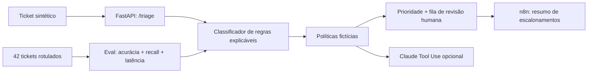

# ResolveAI — triagem auditável de reclamações com IA assistiva, API e evals

**[Demonstração interativa (GitHub Pages)](https://pedromfr09.github.io/resolveai-ai/)** · [Execução n8n validada](docs/N8N_VALIDATION.md) · [Avaliações e testes](docs/PHASE1_2_VALIDATION.md)

**Projeto independente de portfólio AI Builder.** Simula uma fila de atendimento e transforma reclamações em classificações, prioridades, roteamento e rascunhos **não enviados**. **Não é um sistema oficial, integrado ou afiliado ao iFood.** Todos os tickets, critérios de SLA e políticas são fictícios.

**Resultados locais verificados:** 27 testes; 42/42 categorias no conjunto inicial; 8/8 no desafio após ajuste das regras; n8n 2.48.4 executado pela CLI e pelo editor com quatro tickets e três revisões humanas por execução. O desafio orientou correções e não é validação independente. Claude é opcional e **não foi validado com a API Anthropic neste projeto**.

## Evidências para revisão técnica

| O que inspecionar | Arquivos |
|---|---|
| Demo estática, sem backend | [Abrir index.html](index.html) e [publicação no Pages](docs/PUBLISHING.md) |
| Testes e API por HTTP real | [Validação das Fases 1 e 2](docs/PHASE1_2_VALIDATION.md), [JUnit](reports/pytest.xml), [requisições e respostas](reports/api_validation.json) |
| Evals e matrizes de confusão | [42 tickets](reports/evaluation.json), [8 desafios](reports/evaluation_challenge.json), [baseline 7/8](reports/evaluation_challenge_baseline.json) |
| Automação executada | [Validação n8n e capturas](docs/N8N_VALIDATION.md), [execuções sanitizadas](reports/n8n_execution.json), [JSON real do editor](reports/n8n_editor_digest.json) |

O `index.html` contém decisões pré-calculadas e funciona sem FastAPI ou n8n. GitHub Pages publica apenas essa demonstração estática; não hospeda os serviços Python e n8n.

## Problema que o projeto aborda

Uma equipe de suporte precisa separar reclamações simples de ocorrências que exigem prioridade, associar responsáveis, registrar evidências e evitar que respostas de IA resultem em promessas indevidas. O sistema automatiza a **triagem inicial simulada**, mantendo revisão humana para alto risco. Diferentemente de um dashboard de pedidos, o foco é fluxo de atendimento, governança e avaliação.

## Arquitetura



**Importante: a triagem automática é determinística.** A camada Claude implementa uma conversação com *tool use* mas sua execução com API real depende de credenciais e ainda requer validação; não confundir `evals` locais com avaliações de um LLM. As regras de risco têm prioridade sobre o texto da IA. Nada envia mensagens, acessa pedidos reais ou executa reembolsos.

## Funcionalidades implementadas

| Funcionalidade | Evidência |
|---|---|
| POST `/triage` e POST `/triage/batch` | FastAPI + testes automatizados |
| GET `/health`, `/demo`, `/policies` | Executável sem serviços externos |
| Priorização, roteamento, rascunho e rastreio de regras | `resolveai/core.py` |
| Fila de revisão humana para alertas críticos | Guardrails determinísticos + testes |
| Avaliação quantitativa (`evals`) com matriz de confusão | `scripts/evaluate.py`, 42 exemplos iniciais + 8 casos desafiadores |
| Orquestração Claude com duas ferramentas somente de leitura | `resolveai/agent.py` + teste do ciclo usando LLM simulado |
| Fluxo n8n importável (4 tickets → API → digest) | `automation/n8n_resolveai_manual.json` |
| Variante para n8n rodando em Docker | `automation/n8n_resolveai_docker.json` |

## Instalar e rodar (Windows PowerShell)

```powershell
# Dentro da pasta ResolveAI
py -3.12 -m venv .venv
.\.venv\Scripts\Activate.ps1
python -m pip install -r requirements-dev.txt
python -m pytest -q
python scripts/evaluate.py --output reports/evaluation.json
python scripts/evaluate.py --data data/tickets_challenge.jsonl --output reports/evaluation_challenge.json
python -m uvicorn resolveai.api:app --host 127.0.0.1 --port 8001
```

Acesse **http://127.0.0.1:8001/docs** (Swagger) ou **http://127.0.0.1:8001/demo**.

Use Python **3.12**. Se o launcher `py` não estiver disponível, use o caminho completo do executável Python 3.12 instalado para criar o ambiente. Para repetir a validação HTTP real, com o Uvicorn aberto, execute `python scripts/validate_api.py`. As requisições e respostas ficam em `reports/api_validation.json`.

**Validação da API em 16/11/2026:** 27 testes passaram; HTTP real na porta 8001. Os quatro tickets do workflow retornaram três revisões humanas via API. Essa evidência está em [Fases 1 e 2](docs/PHASE1_2_VALIDATION.md); a execução posterior do workflow está documentada separadamente em [validação n8n](docs/N8N_VALIDATION.md).

Teste via PowerShell em um segundo terminal:

```powershell
$body = @{ticket_id="DEMO-007";text="Minha conta foi invadida e não reconheço o acesso"} | ConvertTo-Json
Invoke-RestMethod -Uri "http://127.0.0.1:8001/triage" -Method Post -ContentType "application/json" -Body $body
```

## Executar o workflow n8n realmente

1. **Mantenha a API acima aberta** na porta 8001.
2. Prepare o npm local e inicie n8n 2.48.4 conforme [instruções validadas](docs/N8N_VALIDATION.md). Importe `automation/n8n_resolveai_manual.json` quando n8n executar no Windows com acesso à API no host.
3. No n8n, **Import from File** e escolha o JSON. Confirme a URL dentro do nó `POST ResolveAI API` (a variante Docker está preparada, mas não foi executada nesta validação; para instalação local use `http://127.0.0.1:8001/triage`).
4. Clique **Execute Workflow**. A saída esperada do último nó é `total_processed: 4`, `escalated_count` e `escalated`. **Somente depois de confirmar a saída poderá dizer que o fluxo n8n foi executado.** Salve uma captura do canvas com os nós verdes e do JSON de saída.

Veja o [roteiro de validação do n8n](docs/N8N_VALIDATION.md) para registrar evidências após a execução.

**Execução real validada em 16/11/2026:** n8n **2.48.4** no Windows, integrado à FastAPI local. O workflow original concluiu pela CLI e pelo botão Execute do editor: **4 processados, 3 encaminhamentos humanos**, prioridades `alta: 2`, `critica: 1`, `media: 1` em cada execução. [Resultados, capturas e reprodução](docs/N8N_VALIDATION.md); [saídas reais dos quatro nós](reports/n8n_execution.json). Sem chamadas à Anthropic, notificações externas ou ações de atendimento.

## Avaliação / métricas

```powershell
python scripts/evaluate.py --output reports/evaluation.json
python scripts/evaluate.py --data data/tickets_challenge.jsonl --output reports/evaluation_challenge.json
```

O arquivo `reports/evaluation.json` guarda acurácia, recall de prioridades altas, recall de revisão humana, matriz de confusão, divergências e latência de processamento. Em 16/11/2026: **42/42 categorias corretas** no conjunto inicial e **8/8 no desafio**, após correção da regra para “gosto estranho”. O desafio também teve **2/2 casos de alta prioridade reconhecidos**. A execução anterior, preservada em `reports/evaluation_challenge_baseline.json`, teve **7/8 (87,5%)**: `CH008` foi classificado como `outros`, com revisão humana desnecessária. As métricas atuais incluem ajuste orientado por esse exemplo. Ambos os conjuntos foram construídos durante o desenvolvimento; o desafio ajudou a refinar regras e **não constitui validação independente ou teste cego**. Os dados foram **criados manualmente para este MVP**; métricas altas neles **não demonstram generalização**, desempenho de LLM ou economia de tempo real. `elapsed_ms_total` muda conforme a máquina.

Para melhorar a avaliação após a candidatura: adicionar mensagens ambíguas, negações, ironia, exemplos adversariais, casos reais anonimizados com permissão e um conjunto de teste externo.

## Claude Tool Use: componente opcional

`resolveai/agent.py` contém um loop real de mensagens e chamadas a `get_ticket_triage` e `lookup_demo_policy`. `POST /agent/claude` é habilitado apenas com `ANTHROPIC_API_KEY` e `ANTHROPIC_MODEL` definidos no ambiente; o SDK `anthropic` precisa estar instalado separadamente. O projeto **não precisa dessa integração para a API, os evals e o n8n funcionarem**. O teste usa um cliente simulado para validar o protocolo do loop e **não comprova chamadas à API Anthropic**.

## Abordagem de segurança e limitações

- Nenhuma ação de atendimento é executada: rascunhos precisam de aprovação antes de uso.
- Sinais de saúde, fraude ou acesso indevido causam escalonamento; há falsos positivos e falsos negativos possíveis.
- O `redact()` faz redação básica de emails/telefones/numeração longa, **não é anonimização suficiente para uso em produção**.
- Rótulos de urgência, SLAs e políticas são fictícios, não são políticas corporativas do iFood.
- O serviço não implementa autenticação nem rate limiting; destina-se apenas a execução local.
- Nenhum ganho de tempo em ambiente produtivo foi medido. As latências locais **não são ROI**.

## Demonstração recomendada (90 segundos)

1. Swagger `/docs`: envie uma reclamação genérica e confira categoria/equipe.
2. Envie relato de alergia: prioridade `critica`, `requires_human_review: true`, justificativa rastreável.
3. Abra os relatórios de avaliação e explique os resultados: 42/42 no inicial; desafio de 7/8 para 8/8 após ajuste das regras, com baseline preservado e sem validação independente.
4. Execute o n8n: quatro casos de teste → API → resumo de escalonamentos.
5. Se posteriormente tiver credenciais válidas, apresente o Claude Tool Use como camada explicativa opcional.

## Arquivos principais

```text
resolveai/
  core.py          # Regras + políticas fictícias + decisão
  api.py           # 6 endpoints FastAPI
  agent.py         # Claude Tool Use opcional
scripts/
  evaluate.py      # Avaliação da triagem determinística
  create_dataset.py
 data/tickets_labeled.jsonl  # 42 casos sintéticos rotulados
 automation/        # Dois fluxos n8n para ambientes diferentes
 tests/             # Testes automatizados
 reports/evaluation.json e reports/evaluation_challenge.json
```

## Autoria e transparência

MVP de demonstração desenvolvido com assistência de IA. O responsável deve validar, adaptar, executar e compreender os componentes antes de apresentá-lo como experiência profissional. O fluxo não está em produção.
