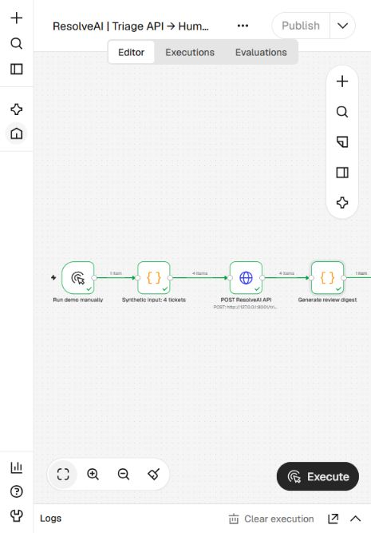
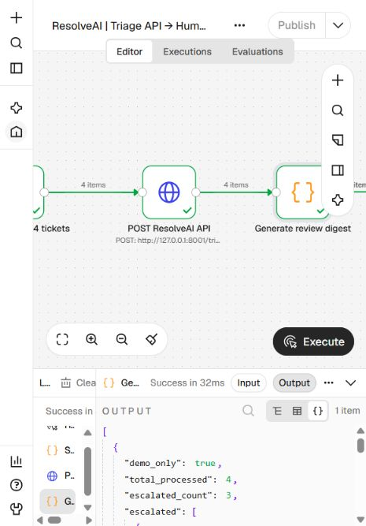

# n8n — execução real validada

**Validado em 16/11/2026, Windows, n8n 2.48.4, Node.js v24.22.1 e npm 12.2.2 local.** O workflow existente foi importado e executado no runtime do n8n, integrado à FastAPI por HTTP real. Sem chamadas à Anthropic ou publicação no GitHub.

## Resultado observado

Arquivo: `automation/n8n_resolveai_manual.json`, sem alteração dos nós, entradas ou lógica. Identificador local: `vHydbEx3lFahh5II`.

| Execução | Modo | Início, America/Sao_Paulo | Fim | Status |
|---|---|---|---|---|
| 1 | CLI oficial `n8n execute` | 16/11/2026 20:14:02.770 | 20:14:06.918 | `success` |
| 2 | Botão Execute no editor | 16/11/2026 20:18:02.379 | 20:18:03.283 | `success` |

Horários registrados pelo banco local; o relatório preserva os timestamps UTC. Cada execução processou quatro tickets; a repetição no editor gerou outras quatro requisições locais.

```json
{
  "total_processed": 4,
  "escalated_count": 3,
  "priority_counts": {"alta": 2, "critica": 1, "media": 1}
}
```

| Ticket sintético | Categoria obtida | Prioridade | Equipe | Revisão humana |
|---|---|---|---|---|
| DEMO-001 — atraso de 3 horas | `entrega_atrasada` | `alta` | `operacoes_entrega` | Sim |
| DEMO-002 — cobrança duplicada | `cobranca` | `alta` | `suporte_pagamentos` | Sim |
| DEMO-003 — alergia/hospital | `qualidade_alimento` | `critica` | `suporte_qualidade` | Sim |
| DEMO-004 — dificuldade de login | `acesso_conta` | `media` | `seguranca_conta` | Não |

Os quatro nós concluíram: **Run demo manually → Synthetic input: 4 tickets → POST ResolveAI API → Generate review digest**. O HTTP enviou cada ticket para `POST http://127.0.0.1:8001/triage`. Os logs da FastAPI registraram oito respostas 200 nas duas execuções. O JSON do editor foi copiado por **Copy to Clipboard** e comparado com o da CLI: idênticos.

## Evidências

- [Saídas reais dos quatro nós e metadados das execuções](../reports/n8n_execution.json).
- [JSON copiado do editor](../reports/n8n_editor_digest.json).
- O relatório inclui versão, IDs, status e SHA-256 do workflow original. Tokens internos e dados da conta local foram excluídos.
- A largura reduzida do navegador limita o JSON visível nas capturas; o arquivo acima contém a saída completa.





## Ambiente e reprodução

FastAPI em `127.0.0.1:8001`; editor em **http://localhost:5678**, escutando somente em `127.0.0.1:5678`. Não foi usado Docker, túnel, instalação global ou alteração permanente do PATH.

O Node.js era compatível, mas `npm --version` inicialmente falhou porque npm não estava no PATH. npm 12.2.2 foi baixado para `.local-tools/npm`; n8n 2.48.4 foi instalado via npx com cache `.npm-cache`. Banco, chaves e conta ficam em `.n8n-local`. Essas três pastas e os logs estão ignorados pelo Git.

Em uma nova cópia, prepare o npm local (requer rede):

```powershell
New-Item -ItemType Directory -Force -Path .local-tools/npm | Out-Null
$npmInfo = Invoke-RestMethod https://registry.npmjs.org/npm/12.2.2
Invoke-WebRequest -Uri $npmInfo.dist.tarball -OutFile .local-tools/npm.tgz
tar -xzf .local-tools/npm.tgz -C .local-tools/npm
node .local-tools/npm/package/bin/npm-cli.js --version
```

Com a FastAPI aberta, inicie o editor em outro terminal:

```powershell
.\scripts\start_n8n.ps1
```

O script fixa `n8n@2.48.4`, permite apenas o script necessário do SQLite e usa variáveis no processo local. Diagnósticos, notificações de versão e templates ficam desligados nessa instância demonstrativa.

Para importar pela CLI em uma instância nova:

```powershell
.\scripts\start_n8n.ps1 -N8nArguments @('import:workflow','--input=automation/n8n_resolveai_manual.json')
.\scripts\start_n8n.ps1 -N8nArguments @('list:workflow')
```

Use o ID retornado, sem reimportar se o workflow já existe. Para executar pela CLI, pare primeiro o editor para evitar disputa pela porta do task broker:

```powershell
.\scripts\start_n8n.ps1 -N8nArguments @('execute','--id=ID_RETORNADO','--rawOutput') |
  Set-Content -Encoding utf8 .local-tools/n8n-execution-raw.log
.\.venv\Scripts\python.exe scripts/export_n8n_evidence.py
```

O bruto contém tokens internos e **deve permanecer local**. O exportador valida os resultados e publica somente campos selecionados. O JSON do editor e as capturas correspondem a esta sessão: ao refazer evidências, atualize-os para a nova execução ou remova as cópias antigas antes de exportar.

Para repetir pela interface:

1. Acesse `http://localhost:5678`. Em instalação nova, o proprietário cria a própria senha em **Set up owner account**.
2. Em **Overview → Workflows**, abra o workflow ResolveAI.
3. Clique **Execute** e aguarde **Workflow executed successfully**.
4. Abra **Logs → Open panel**, selecione **Generate review digest → Output → JSON**. Confira os totais 4 e 3.
5. Use **Copy to Clipboard** para guardar a saída real. **Edit Output** e **Pin data** não comprovam execução.

## Problemas encontrados

1. **npm/npx ausentes:** resolvido com npm local, sem instalação global.
2. **Importação falhou ao abrir SQLite:** npm 12 bloqueia scripts por padrão; `sqlite3@5.1.7` estava presente sem seu binário nativo. Foi aprovado somente esse pacote no cache local e executado `npm rebuild sqlite3`. O módulo foi carregado com sucesso antes de repetir a importação.
3. **Avisos de dependências transitivas:** depreciações e peer dependencies não impediram esta execução; não foi realizada auditoria de segurança dessas dependências.
4. **Runner Python indisponível:** n8n informou ausência do ambiente de seu runner Python. Este workflow usa somente JavaScript; o **JS Task Runner** foi registrado e executou os dois nós Code. Não instalamos dependências Python adicionais para n8n.
5. **Conta proprietária:** a senha foi criada manualmente pelo usuário. Depois disso, execução e capturas do editor foram automatizadas.

Os testes locais foram repetidos: **27 passaram**, com o aviso de depreciação do TestClient já conhecido. A lógica FastAPI/classificador e os dois JSONs de workflow não foram modificados nesta fase.

## Limitações e ações externas

- Demonstração local com dados, equipes, políticas e SLAs fictícios. Não mede desempenho produtivo ou ganho comercial.
- O único destino HTTP do workflow é a FastAPI local. Os nós Code criam entradas e agregam resultados; não há nó de notificação, reembolso, alteração de conta ou LLM.
- Encaminhamento significa entrada no resumo para revisão humana; nenhuma mensagem ou tarefa foi enviada a sistema externo.
- O workflow permanece sem publicação ou ativação automática, com gatilho manual. Não foi preparado para produção ou execução após reiniciar o computador.
- `/demo` da API usa conta invadida e retorna quatro revisões; o workflow usa dificuldade de login e retorna três. São conjuntos diferentes.
- Nada foi publicado no GitHub. Banco, chaves e logs brutos permanecem locais nas pastas ignoradas.

Referências: [instalação oficial npm/npx](https://docs.n8n.io/hosting/installation/npm/) e [CLI oficial](https://docs.n8n.io/hosting/cli-commands/). A rota npm/npx foi usada na série 2.x; a documentação registra mudanças a partir da série 3.x.
